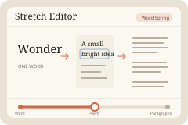

  

# Stretch Editor

  

Didn't work? Create a Studio workspace and paste this to your agent:
` /use-template https://github.com/mrjf/stretch-editor`

## Why you care

Write a document or poem once, then zoom it to any length -- one word, a tweet, a sonnet, three paragraphs -- with every size written ahead by the models you choose.

Rewriting the same idea for every format interrupts the writing itself. Keep one piece of your own, then explore shorter and longer versions without losing the original.

## How to use it

1. Connect a Claude account in Imbue Studio. An OpenAI/ChatGPT account is optional; its models appear alongside Claude when connected.
2. Open Stretch Editor and try one of the three bundled documents, or write a new piece and lock your own version.
3. Choose the models and add an overall brief or notes for individual sizes in Prompts. Set how far ahead the writers should work and how many can write at once.
4. For prose, choose characters, words, sentences, or paragraphs, then use the size controls, labelled zoom slider, or pills such as One word and Tweet. Words glide as you move between prepared versions.
5. For poetry, choose lines and syllables, a rhythm and rhyme pattern, or one of 19 classic forms. Compare model versions and use Most human to find the one closest to your wording.

The tweet preview shows how a short version would look. The three examples include a Claude demo, Millay's public-domain Sonnet XIX, and the stretchtext author's one-line description. Some poetry cells are still empty; filling them with your own writers consumes model usage. Prepared versions remain available to read.

## Ideas for making it yours

- Add a house style for abstracts, newsletters, or product announcements.
- Extend the poetry catalogue with a favorite regional or experimental form.
- Add a side-by-side comparison of two models at the same length.
- Export a chosen set of sizes as a ready-to-publish collection.

## What this is

This repository is a published **Imbue Studio template**: a clean, bootable
snapshot of what an agent built, ready to adapt into your own. It is NOT the
generic workspace template -- it is this specific project.

[`template.md`](template.md) is the full manifest -- what it is, how it
works, what it needs to run, and what to adapt -- with the
machine-readable half (recipe, requirements, and the environment it needs
installed) in [`template.toml`](template.toml).
